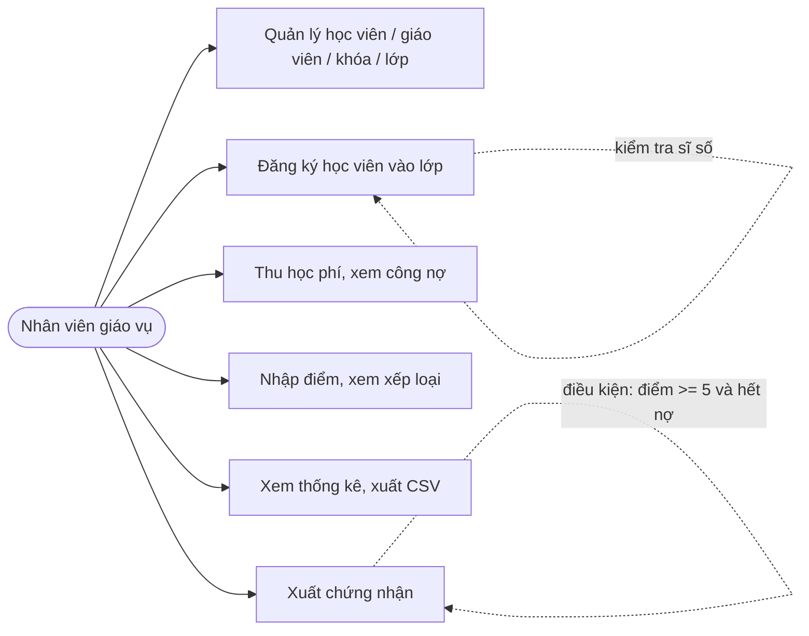
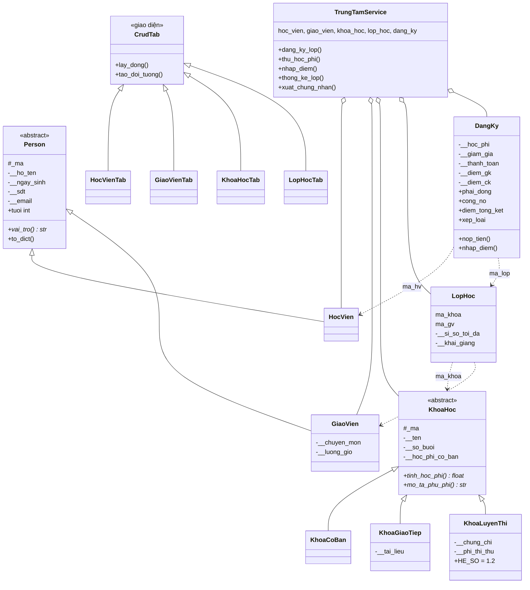

# BÁO CÁO ĐỒ ÁN MÔN LẬP TRÌNH PYTHON
## Đề tài 21: Hệ thống quản lý trung tâm ngoại ngữ

---

## 1. Giới thiệu và phân tích yêu cầu

### 1.1. Mục tiêu
Xây dựng ứng dụng desktop bằng Tkinter giúp trung tâm ngoại ngữ quản lý học viên, giáo viên, khóa học, lớp, học phí, công nợ và kết quả học tập; có thống kê và xuất chứng nhận.

### 1.2. Đối tượng sử dụng
Nhân viên giáo vụ/thu ngân của trung tâm (một người dùng, chạy trên một máy).

### 1.3. Chức năng (đối chiếu yêu cầu đề tài)

| Yêu cầu đề tài | Cách đáp ứng | Vị trí |
|---|---|---|
| CRUD học viên, khóa, lớp | Thêm/sửa/xóa/tìm kiếm trên Treeview; thêm giáo viên | `HocVienTab`, `GiaoVienTab`, `KhoaHocTab`, `LopHocTab` |
| Đăng ký lớp, kiểm tra sĩ số | `dang_ky_lop()` ném `LopDayError` khi lớp đầy, chặn đăng ký trùng | `services.py` |
| Theo dõi học phí, công nợ | Thu nhiều đợt, chặn nộp vượt công nợ, lọc "chỉ hiện còn nợ", xuất CSV công nợ | `DangKyTab` |
| Nhập điểm, xếp loại | Điểm tổng kết = 40% giữa kỳ + 60% cuối kỳ; Giỏi ≥ 8, Khá ≥ 6.5, Trung bình ≥ 5, Yếu < 5 | `DiemTab`, `DangKy` |
| Thống kê lớp và doanh thu | Sĩ số, tỷ lệ lấp đầy, điểm TB, số đạt, phải thu/đã thu/công nợ theo lớp và theo khóa | `ThongKeTab` |
| Notebook, Treeview, DateEntry, Canvas biểu đồ điểm | 7 tab trong `ttk.Notebook`; `DateEntry` tự xây dựng kèm lịch chọn ngày; 2 biểu đồ cột Canvas | `gui.py`, `widgets.py` |
| Nâng cao: kế thừa loại khóa | `KhoaHoc` (ABC) → `KhoaCoBan`, `KhoaGiaoTiep`, `KhoaLuyenThi` | `models.py` |
| Nâng cao: Custom GradeBadge | Widget kế thừa `Canvas`, huy hiệu bo tròn đổi màu theo xếp loại | `widgets.py` |
| Nâng cao: xuất chứng nhận | File HTML đẹp để in; chỉ cấp khi có điểm ≥ 5 và hết nợ học phí | `xuat_chung_nhan()` |
| Dữ liệu JSON/CSV mẫu | `data/trung_tam.json`, `data/hoc_vien.csv`; nhập/xuất CSV học viên | `storage.py` |

### 1.4. Quy tắc nghiệp vụ
1. Mã tự sinh theo tiền tố: `HV001`, `GV001`, `KH001`, `L001`, `DK0001`.
2. Số điện thoại gồm đúng 10 chữ số; ngày sinh không ở tương lai; email (nếu có) đúng dạng `a@b.c`.
3. Học phí của khóa tính **đa hình** theo loại:
   - Cơ bản: học phí cơ bản.
   - Giao tiếp: học phí cơ bản + phí tài liệu.
   - Luyện thi: học phí cơ bản × 1.2 + phí thi thử.
4. Học phí được **chốt tại thời điểm đăng ký**; sửa khóa sau đó không làm đổi học phí đã đăng ký.
5. Phải đóng = học phí × (1 − giảm giá%); công nợ = phải đóng − đã đóng.
6. Không xóa đối tượng đang được tham chiếu (học viên có đăng ký, giáo viên đang dạy, khóa có lớp, lớp có học viên). Không hủy đăng ký đã thu tiền hoặc đã có điểm.
7. Không giảm sĩ số tối đa của lớp xuống dưới sĩ số hiện có.

### 1.5. Các ca sử dụng chính


---

## 2. Thiết kế

### 2.1. Kiến trúc 3 lớp
```
 gui.py / widgets.py   (Giao diện: chỉ hiển thị, đọc form, gọi service)
        │
 services.py           (Nghiệp vụ: quy tắc, thống kê – không phụ thuộc Tkinter)
        │
 models.py             (Mô hình: đóng gói, kế thừa, đa hình, kiểm tra dữ liệu)
        │
 storage.py            (Lưu trữ JSON/CSV)       exceptions.py, utils.py (dùng chung)
```
Nhờ tách lớp, toàn bộ nghiệp vụ được kiểm thử tự động mà không cần mở giao diện.

### 2.2. Sơ đồ lớp

Các lớp liên kết với nhau **bằng mã** (không giữ tham chiếu đối tượng) để việc lưu/nạp JSON đơn giản và tránh vòng tham chiếu.

**Lớp ngoại lệ:** `TrungTamError` là gốc; các lớp con: `DuLieuKhongHopLeError`, `TrungMaError`, `KhongTimThayError`, `LopDayError`, `RangBuocError`, `FileDuLieuError`. Giao diện chỉ cần bắt `TrungTamError` để hiện thông báo thân thiện.

### 2.3. Cấu trúc dữ liệu JSON (`data/trung_tam.json`)
```json
{
  "hoc_vien":  [{"ma": "HV001", "ho_ten": "Phan Thị Mai", "ngay_sinh": "04/01/1997",
                 "sdt": "0988447294", "email": "hv001@mail.com"}],
  "giao_vien": [{"ma": "GV001", "...": "...", "chuyen_mon": "IELTS", "luong_gio": 300000.0}],
  "khoa_hoc":  [{"loai": "Luyện thi", "ma": "KH004", "ten": "Luyện thi IELTS 6.5",
                 "so_buoi": 48, "hoc_phi_co_ban": 5000000.0,
                 "chung_chi": "IELTS", "phi_thi_thu": 600000.0}],
  "lop_hoc":   [{"ma": "L004", "ten": "...", "ma_khoa": "KH004", "ma_gv": "GV001",
                 "si_so_toi_da": 12, "ngay_khai_giang": "10/10/2026", "lich_hoc": "..."}],
  "dang_ky":   [{"ma": "DK0001", "ma_hv": "HV001", "ma_lop": "L004", "ngay_dk": "01/11/2026",
                 "hoc_phi": 6600000.0, "giam_gia": 10.0,
                 "thanh_toan": [{"ngay": "05/11/2026", "so_tien": 3000000.0}],
                 "diem_gk": 7.5, "diem_ck": 8.0}]
}
```
Trường `loai` của khóa học quyết định lớp con được tạo khi nạp (`KhoaHoc.tu_dict`).

### 2.4. Thiết kế giao diện
Cửa sổ chính là `ttk.Notebook` gồm 7 tab:

| Tab | Thành phần chính |
|---|---|
| Học viên, Giáo viên, Khóa học, Lớp học | Ô tìm kiếm + Treeview (trái); form nhập + nút Thêm/Cập nhật/Xóa/Làm trống (phải). Cả 4 tab kế thừa `CrudTab` |
| Đăng ký & Học phí | Combobox chọn học viên/lớp (hiện sĩ số), `DateEntry`, Treeview đăng ký, khung thu học phí, tổng công nợ; dòng còn nợ tô đỏ |
| Điểm & Xếp loại | Chọn lớp → Treeview điểm; `GradeBadge`; biểu đồ phân bố xếp loại và biểu đồ điểm từng học viên (Canvas); nút xuất chứng nhận |
| Thống kê | Tổng quan, bảng thống kê lớp, bảng doanh thu theo khóa, biểu đồ xếp loại toàn trung tâm, xuất CSV |

Dữ liệu được tự động lưu sau mỗi thao tác thành công và khi đóng cửa sổ; lỗi nghiệp vụ hiện bằng hộp thoại, không làm chương trình dừng.

---

## 3. Cài đặt – vận dụng kiến thức các buổi học

| Buổi | Nội dung giáo trình | Vận dụng trong đồ án |
|---|---|---|
| 1 | Biến, kiểu dữ liệu, if/for/while, `range`, ép kiểu | Kiểm tra điều kiện xếp loại, duyệt danh sách, `chuyen_so()` ép kiểu có kiểm tra |
| 2 | Hàm, tham số mặc định, trả nhiều giá trị, `*args`, đệ quy | `ma_tiep_theo()`, `dang_ky_lop(..., giam_gia=0, ngay=None)`, `tinh_trung_binh(*diem)`, `tong_de_quy()` tính tổng tiền đã đóng |
| 3–4 | List, dict, lớp và đối tượng | Kho dữ liệu `dict` theo mã, danh sách thanh toán, list comprehension; các lớp mô hình |
| 5 | Đóng gói: `_x`, `__x`, getter/setter, `@property` | Mọi thuộc tính nhạy cảm là private + `@property` có kiểm tra; mã là `_ma` chỉ đọc; lỗi nhập không làm hỏng giá trị cũ |
| 6–7 | Kế thừa, ghi đè, lớp trừu tượng `ABC`, `@abstractmethod`, `super()`, `isinstance`/`issubclass`, đa hình | `Person`/`KhoaHoc` là lớp trừu tượng; `tinh_hoc_phi()` và `mo_ta_phu_phi()` ghi đè ở từng loại khóa; `CrudTab` kế thừa cho 4 tab; `GradeBadge` kế thừa `Canvas` |
| 8 | File, `with`, CSV, JSON, `try/except/else/finally`, ngoại lệ tự định nghĩa | `storage.py` (JSON, `csv.DictReader`, ghi file tạm + `.bak`), hệ thống `TrungTamError`, `error.log` ghi nối tiếp, không dùng `except` trống |
| 9 | `random`, `sys` | `tao_du_lieu_mau.py`: `seed`, `randint`, `choice`, `choices`, `sample`, `shuffle`; `sys.argv`, `sys.exit` với mã thoát, `sys.stderr`, `sys.version`, `sys.platform` |

### Điểm nhấn kỹ thuật
- **Đa hình thực sự:** `KhoaHocTab` gọi `k.tinh_hoc_phi()` mà không cần biết loại khóa; thêm loại khóa mới chỉ cần thêm một lớp con và đăng ký vào `KHOA_THEO_LOAI`.
- **Nạp dữ liệu bền vững:** bản ghi lỗi (thiếu trường, sai kiểu, tham chiếu không tồn tại) bị bỏ qua, ghi vào `error.log` và báo cho người dùng; ứng dụng vẫn mở được.
- **Ghi file an toàn:** ghi ra file tạm rồi `os.replace`, giữ bản sao lưu `.bak` của lần lưu trước.
- **Tái lập dữ liệu mẫu:** cùng `seed` luôn sinh cùng bộ dữ liệu.
- **DateEntry tự xây dựng:** không cần cài thêm `tkcalendar`; lịch chọn ngày dùng module `calendar` của Python.

---

## 4. Kiểm thử

### 4.1. Kiểm thử tự động
Chạy: `python -m unittest discover -s tests -v` → **35 test, tất cả đạt**.

| Nhóm | Số test | Nội dung chính |
|---|---|---|
| Đóng gói | 4 | Chuẩn hóa họ tên; setter chặn dữ liệu sai nhưng giữ giá trị cũ; thuộc tính private; mã chỉ đọc |
| Kế thừa – đa hình | 6 | Lớp trừu tượng không khởi tạo được; học phí 3 loại khóa; `isinstance`/`issubclass`; chứng chỉ sai; `tu_dict`; factory |
| Nghiệp vụ | 17 | Trùng mã; sinh mã; sĩ số đầy; đăng ký trùng; đăng ký đối tượng không tồn tại; học phí–công nợ; nộp vượt/âm/không phải số; giảm giá ngoài miền; điểm và xếp loại; biên xếp loại; ràng buộc xóa; hủy đăng ký; giảm sĩ số; tham chiếu lớp; học phí chốt; thống kê; chứng nhận |
| Lưu trữ | 6 | Lưu–nạp–`.bak`; file không tồn tại; JSON hỏng/sai cấu trúc; bản ghi lỗi bị bỏ qua; nhập CSV; xuất CSV |
| Tiện ích | 2 | `chuyen_so`, `tong_de_quy` |

### 4.2. Các ca kiểm thử tiêu biểu

| STT | Thao tác | Dữ liệu | Kết quả mong đợi | Kết quả |
|---|---|---|---|---|
| 1 | Thêm học viên | Họ tên `"  nguyễn   văn  an "` | Lưu thành `Nguyễn Văn An` | Đạt |
| 2 | Thêm học viên | SĐT `123` | Báo lỗi SĐT phải 10 chữ số | Đạt |
| 3 | Thêm học viên | Ngày sinh `31/02/2000` | Báo ngày không hợp lệ | Đạt |
| 4 | Đăng ký lớp sĩ số tối đa 2 | Học viên thứ 3 | `LopDayError` | Đạt |
| 5 | Đăng ký lặp lại cùng lớp | Cùng học viên | Báo đã đăng ký | Đạt |
| 6 | Học phí khóa Luyện thi | Cơ bản 5.000.000, thi thử 600.000 | 6.600.000 đ | Đạt |
| 7 | Giảm 10% học phí 3.000.000 | — | Phải đóng 2.700.000 đ | Đạt |
| 8 | Thu học phí | Nộp 9.999.999.999 | `RangBuocError` (vượt công nợ) | Đạt |
| 9 | Nhập điểm | Giữa kỳ 11 | Báo điểm phải ≤ 10, điểm cũ giữ nguyên | Đạt |
| 10 | Điểm 8 và 9 | — | Tổng kết 8.6, xếp loại Giỏi | Đạt |
| 11 | Xóa học viên đã đăng ký | — | `RangBuocError` | Đạt |
| 12 | Xuất chứng nhận khi còn nợ / điểm < 5 / chưa có điểm | — | Từ chối kèm lý do | Đạt |
| 13 | Mở file JSON hỏng | `{ khong phai json` | `FileDuLieuError`, chương trình không crash | Đạt |
| 14 | Nạp JSON có bản ghi sai | 5 bản ghi lỗi | Bỏ qua 5, nạp phần hợp lệ, ghi log | Đạt |
| 15 | Nhập CSV mẫu | `data/hoc_vien_nhap_mau.csv` (5 dòng, 3 dòng lỗi) | 2 dòng thành công, 3 dòng báo lỗi kèm số dòng | Đạt |

### 4.3. Kiểm thử giao diện
Phần logic của giao diện (đổ dữ liệu vào Treeview, đọc form, xử lý lỗi, làm mới giữa các tab, vẽ biểu đồ) được chạy thử bằng một bản giả lập Tkinter với kịch bản: thêm/sửa học viên, thêm khóa luyện thi, tạo lớp, đăng ký, lớp đầy, thu học phí, lọc công nợ, nhập điểm hợp lệ/sai, xuất chứng nhận, xóa bị chặn, lưu khi thoát – tất cả cho kết quả đúng.
**Cần chạy thử trực tiếp trên máy có Tkinter** để chụp ảnh màn hình đưa vào báo cáo (các bước ở mục 5).

---

## 5. Hướng dẫn sử dụng

### 5.1. Cài đặt và chạy
1. Cài Python 3.8 trở lên (bản cài đặt trên Windows/macOS đã kèm Tkinter; Linux: `sudo apt install python3-tk`).
2. Giải nén thư mục dự án, mở terminal tại thư mục đó.
3. Chạy `python main.py`. Dữ liệu mẫu nằm ở `data/trung_tam.json`.
4. Muốn bắt đầu với dữ liệu trống: `python main.py du_lieu_moi.json`.

### 5.2. Quản lý danh mục (tab Học viên, Giáo viên, Khóa học, Lớp học)
- **Thêm:** nhập form bên phải → **Thêm** (mã tự sinh).
- **Sửa:** bấm một dòng trong bảng, sửa form → **Cập nhật**.
- **Xóa:** chọn dòng → **Xóa** → xác nhận. Đối tượng đang được dùng sẽ không xóa được.
- **Tìm kiếm:** gõ vào ô *Tìm kiếm* phía trên bảng.
- Ô ngày: gõ `dd/mm/yyyy` hoặc bấm nút ▾ để chọn trên lịch.
- Tab Khóa học: chọn *Loại khóa*; ô *Phụ phí* là phí tài liệu (Giao tiếp) hoặc phí thi thử (Luyện thi); chọn *Chứng chỉ* khi là khóa Luyện thi.
- Tab Học viên có nút **Nhập từ CSV…** (cột `ho_ten`, `ngay_sinh`, `sdt`, bắt buộc; `ma`, `email` tùy chọn) và **Xuất CSV…**.

### 5.3. Đăng ký và thu học phí (tab Đăng ký & Học phí)
1. Chọn học viên, chọn lớp (hiển thị sĩ số `hiện có/tối đa`), nhập giảm giá nếu có, chọn ngày → **Đăng ký**.
2. Chọn một dòng đăng ký, nhập *Số tiền nộp* và *Ngày nộp* → **Thu học phí** (có thể thu nhiều đợt).
3. Tích **Chỉ hiện còn nợ** để lọc; **Xuất công nợ CSV…** để lưu danh sách.
4. **Hủy đăng ký** chỉ dùng được khi chưa thu tiền và chưa có điểm.

### 5.4. Nhập điểm và chứng nhận (tab Điểm & Xếp loại)
1. Chọn lớp, bấm vào học viên, nhập điểm giữa kỳ và cuối kỳ (thang 10) → **Lưu điểm**. Huy hiệu xếp loại và hai biểu đồ cập nhật ngay.
2. **Xuất chứng nhận** tạo file `chung_nhan/ChungNhan_<mã đăng ký>.html` cạnh file dữ liệu; mở bằng trình duyệt để in hoặc lưu PDF. Chỉ cấp khi điểm tổng kết ≥ 5 và học phí đã đóng đủ.

### 5.5. Thống kê (tab Thống kê)
Xem tổng quan trung tâm, thống kê từng lớp, doanh thu theo khóa và biểu đồ xếp loại; **Xuất thống kê lớp CSV…** để mở bằng Excel (UTF-8 có BOM nên không lỗi font).

### 5.6. Sinh dữ liệu mẫu
```
python tao_du_lieu_mau.py [seed] [so_hoc_vien] [duong_dan_json]
```
Ví dụ `python tao_du_lieu_mau.py 2026 30`. Mã thoát: 0 thành công, 1 tham số sai, 2 lỗi ghi file.

### 5.7. Xử lý sự cố
| Hiện tượng | Cách xử lý |
|---|---|
| Báo "Thiếu Tkinter" | Cài `python3-tk` (Linux) hoặc cài lại Python bản đầy đủ |
| Báo "File JSON sai định dạng" | Khôi phục từ `trung_tam.json.bak` (bản lưu trước đó) |
| Cảnh báo "bỏ qua bản ghi" khi mở | Xem `error.log` để biết bản ghi nào lỗi và vì sao |
| Không xóa được đối tượng | Hủy các đăng ký/lớp liên quan trước (xem thông báo lỗi) |

---

## 6. Kết luận và hướng phát triển
**Kết quả:** ứng dụng đáp ứng đầy đủ chức năng bắt buộc và cả ba nội dung nâng cao; nghiệp vụ tách khỏi giao diện nên kiểm thử tự động được (35 test đạt); vận dụng đủ các nội dung Buổi 1–9.
**Hạn chế:** một người dùng, một máy; dữ liệu JSON phù hợp quy mô nhỏ; chưa có lịch học/điểm danh; chưa phân quyền.
**Hướng phát triển:** chuyển lưu trữ sang SQLite; thêm điểm danh và thời khóa biểu chống trùng phòng/giáo viên; phân quyền đăng nhập; xuất chứng nhận PDF; thêm loại khóa học mới nhờ cơ chế đăng ký lớp con.
